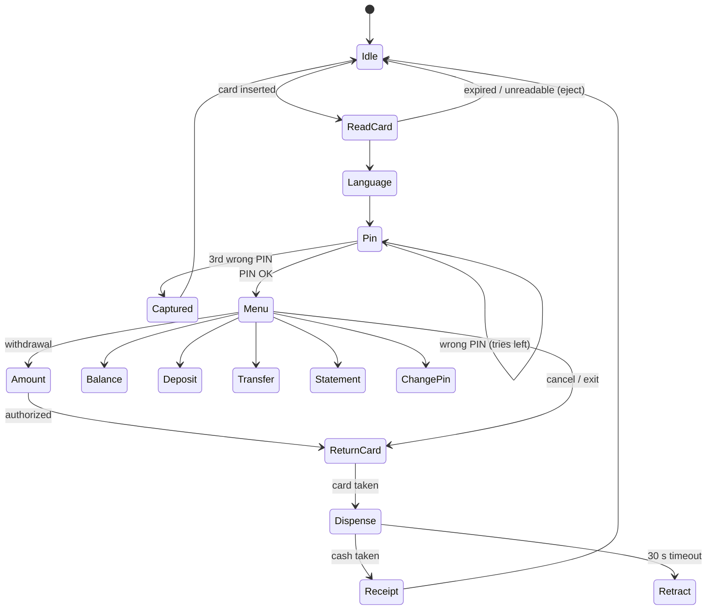

# ATM Simulator v3: Review and Plan

This document reviews the current code (`ATM.cpp`, v2) and lays out a plan for
v3: a reusable C++ core, a realistic GUI, and an interactive demo. A working
prototype of the GUI is already in [`demo/index.html`](../demo/index.html).
Open it in any browser, no build needed.

---

## 1. Review of v2

### What works

- One file, compiles cleanly with `g++ -Wall -Wextra -std=c++17`.
- PIN gate, deposit / withdraw / balance / payment, file persistence.
- Bad input to the menu and the amount prompts is handled (`cin.clear()` + `ignore`).
- The roadmap is already written down (Phase 1 to 4 comments).

### Bugs (all reproduced)

| # | Problem | How to reproduce | Effect |
|---|---------|------------------|--------|
| B1 | **Infinite loop on end of input.** `cin >> option` fails at EOF, `option` becomes `-1`, the loop never ends. | `printf '1234\n' \| ./atm` | Prints the menu forever, 100% CPU. |
| B2 | **Integer overflow.** No upper bound on deposits; `balance` is a signed `int`. | Deposit `2147483647`, then deposit `10`. | Balance becomes `-2147483639` and is saved to disk. Signed overflow is undefined behaviour in C++. |
| B3 | **PIN parsed as a number.** | Enter `01234` as PIN. | Access granted. `0000` and `0` are also the same PIN. Leading-zero PINs can't exist. |
| B4 | **Unlimited PIN attempts across runs.** One wrong PIN exits, but you can just restart. | Run again. | No lock-out, no attempt counter. |
| B5 | **Bank names with spaces break the payment flow.** `cin >> bankName` reads one word. | Bank name `Deutsche Bank`. | `Bank` becomes the account number, the account number becomes the amount, the payment fails. |
| B6 | **Trailing junk leaks into the next prompt.** | Deposit `50abc`. | `50` is deposited, then `abc` is read as a menu choice ("Invalid option"). |
| B7 | **`balance.txt` is tracked by git but empty**, and the program writes it to the current directory. | `git status` after any run. | Every run dirties the working tree; the commit message says the file contains `500`, it actually has 0 bytes. |
| B8 | Save errors are silently ignored. | Run from a read-only directory. | Money "changes" are lost without a message. |

### Design issues

- **Global state** (`balance`, `PIN`) and I/O mixed into the business logic. No
  function can be tested without `cin`/`cout`, and no GUI can reuse it.
- **Money as `int`** with no currency or cents. Real systems use integer minor
  units (cents) in a 64-bit type.
- **No cash model.** A real ATM can only pay out what its cassettes hold, in
  multiples of the smallest note, up to a daily limit.
- **No transaction history**, so no mini-statement, receipt or audit trail.
- The roadmap lives in code comments; the README has no build instructions and
  does not mention the PIN (`1234`).
- `.gitignore` lists `atm` twice.

---

## 2. Goals for v3

1. **Feels like a real ATM.** Card in, language, PIN, menu, card out *before*
   cash, cash retract on timeout, receipt, card capture after 3 wrong PINs.
2. **One core, several front ends.** All rules live in a tested C++ library; the
   CLI and the GUI are thin layers on top.
3. **Correct money handling.** 64-bit cents, limits, overdraft checks, note mix
   against real cassette inventory.
4. **Multi-account** (your Phase 1), **themes** (Phase 2), **menu state
   machine** (Phase 3), **footer** (Phase 4).
5. **Zero-install demo** anyone can open from a link.

---

## 3. Architecture

```
            ┌──────────────────────────────────────────┐
            │                atm-core (C++17)          │
            │                                          │
            │  Money      Account     Card     Bank    │
            │  CashDispenser (cassettes, note mix)     │
            │  AtmStateMachine  ←→  Journal            │
            └──────▲──────────────────────▲────────────┘
                   │                      │
        ┌──────────┴───────┐   ┌──────────┴──────────────────┐
        │   atm-cli        │   │   atm-web (GUI)             │
        │   terminal,      │   │   HTML/CSS fascia from the  │
        │   ANSI themes    │   │   demo + core compiled to   │
        │                  │   │   WebAssembly (Emscripten)  │
        └──────────────────┘   └─────────────────────────────┘
```

### Core types

| Type | Responsibility |
|------|----------------|
| `Money` | `int64_t cents`, checked add/subtract, formatting per locale. Fixes B2. |
| `Card` | Masked PAN, expiry, `std::string` PIN hash (+ salt), retry counter. Fixes B3/B4. |
| `Account` | Checking + savings balance, daily withdrawal limit, transaction list. |
| `Bank` (interface) | `authorize(card, pin)`, `withdraw`, `deposit`, `transfer`. `FileBank` stores JSON in a user data directory, not the repo (B7, B8). |
| `CashDispenser` | Cassettes `{denomination, count}`, `mix(amount)` that returns the fewest notes (max 40) or fails, `present()`, `retract()`. |
| `AtmStateMachine` | Pure state machine: `onCardInserted`, `onKey`, `onFunctionKey`, `onTimeout`, `onCardTaken`, `onCashTaken`. Emits *screen* and *device* commands. No I/O. |
| `Journal` | Append-only electronic journal (like a real ATM's EJ). |

### State machine (the same flow the demo implements)



Every input screen has an inactivity timer: after 30 s it asks "Do you need
more time?", after another 15 s it cancels and returns the card.

### GUI choice

| Option | Realism | Effort | Runs where | Verdict |
|--------|---------|--------|------------|---------|
| **HTML/CSS fascia + core in WebAssembly** | Highest (CSS gives brushed metal, glass, LEDs, motion; Web Audio for sounds) | Medium | Any browser, phone included; can be wrapped as a desktop app | **Recommended** |
| Qt 6 / QML | High | High (toolchain, licensing, deployment) | Desktop | Good second choice for a native app |
| Dear ImGui | Low (looks like a tool, not a machine) | Low | Desktop, also WASM | Good for an operator/debug panel only |

The demo in `demo/` is the GUI prototype. In Phase 4 its JavaScript logic is
replaced by calls into the compiled core, so both front ends share the same
rules.

### Proposed repository layout

```
ATM/
├── CMakeLists.txt
├── core/            include/atm/*.hpp, src/*.cpp
├── cli/             main.cpp (current ATM.cpp, rewritten on top of core)
├── web/             index.html (from demo/), bindings.cpp (embind)
├── tests/           doctest unit tests for core
├── demo/            standalone prototype (kept as the no-build demo)
├── docs/            this plan
└── .github/workflows/ci.yml   build + tests on push
```

---

## 4. Phases

Each phase ends in something that runs.

### Phase 0: Fix v2 (small, do first)

- B1: treat EOF as exit (`if (!cin) break;`).
- B2: cap single deposits (e.g. 10,000) and use `long long`.
- B3/B4: read the PIN as a 4-digit string; lock after 3 tries (persisted).
- B5/B6: read whole lines with `getline` and parse them strictly.
- B7: `git rm --cached balance.txt`, add it to `.gitignore`.
- B8: report save failures.
- README: build/run instructions and the demo PIN.

**Done when:** each repro in the table above behaves correctly.

### Phase 1: Core library + tests

- `Money`, `Card`, `Account`, `CashDispenser`, `AtmStateMachine`, `Journal`.
- CMake project, doctest, GitHub Actions CI.
- Unit tests: overflow, note mix (incl. "cassette empty" and "not a multiple
  of 10"), PIN lock-out, daily limit, card-before-cash ordering, cash retract.

**Done when:** `cmake --build build && ctest` passes in CI.

### Phase 2: Multi-account bank (your Phase 1)

- `FileBank` with 3 demo cards (normal, low balance, expired), JSON storage in
  the user data directory.
- Checking + savings, transfers between own accounts and to another account
  number, mini statement.

### Phase 3: CLI on top of the core (your Phases 2–4)

- `cli/main.cpp` drives `AtmStateMachine`; ANSI colour themes (classic green,
  modern blue) selectable with `--theme`; clear screen and boxed layout.
- Copyright footer as a `constexpr` string, printed on exit.

### Phase 4: Web GUI on the core

- Compile `core/` with Emscripten, expose the state machine via embind.
- Swap the JavaScript logic in the demo for the WASM calls; keep the fascia,
  sounds and animations.
- Publish via GitHub Pages.

### Phase 5: Polish

- Accessibility: full keyboard control (already in the demo), screen reader
  announcements for screen changes, audio guidance like a real ATM headphone jack.
- More languages, high-contrast theme, operator mode (refill cassettes, read
  journal, clear captured cards).

---

## 5. The demo (`demo/index.html`)

A single self-contained file. Open it locally (`xdg-open demo/index.html`,
`open demo/index.html`, or double-click). What it simulates:

- **Fascia:** topper, screen with 4 + 4 side function keys, encrypting PIN pad
  (Cancel / Clear / Enter, tactile dot on 5), card reader with flashing guide
  light, receipt printer, cash shutter.
- **Cards in a wallet:** click a card to insert it. Its PIN is on the sticky
  note. One card is expired, one has a low balance.
- **Full transaction flow:** language choice, PIN with 3-try capture, fast cash,
  other amount, balance, deposit (notes from your wallet are counted and can be
  cancelled), transfers, mini statement, PIN change.
- **Real-machine behaviour:** card is returned before cash; cash is retracted
  after 30 s if not taken; inactivity prompt; note mix limited by cassette
  stock; daily limit; amounts must be multiples of 10.
- **Receipts** print with ATM ID, terminal sequence number and auth code.
- **Electronic journal and cassette levels** in the side panel.
- **Sound:** key beeps, card motor, note counting, printer (Web Audio, no files).
- **Keyboard:** digits, Enter, Backspace = Clear, Esc = Cancel.
- State is kept in `localStorage`; "Reset demo" restores everything.

All names, card numbers and the bank ("Brainhub24 Bank") are fictional. The
notes are drawn as plain coloured rectangles marked DEMO.
